# ha-sports-card

[](https://www.home-assistant.io/integrations/marketplace/)
[](https://github.com/juju35/ha-sports-card/actions/workflows/hacs.yml)
[](https://github.com/juju35/ha-sports-card/actions/workflows/validate.yml)
[](https://github.com/juju35/ha-sports-card/actions/workflows/lint.yml)
[](https://github.com/juju35/ha-sports-card/releases/latest)
[](https://github.com/juju35/ha-sports-card/blob/main/LICENSE)
[](https://buymeacoffee.com/julienstep9)

<p align="center">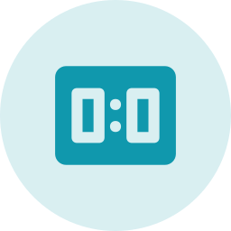</p>

<p align="center">
  
</p>

A Lovelace card for **your teams**, from TeamTracker: the live game as a scoreboard, the next game before kick-off with its time and channel, and the result after; one tab per team when you follow several.

[](https://my.home-assistant.io/redirect/marketplace_repository/?owner=juju35&repository=ha-sports-card&category=plugin)

| Card | Type | What it shows |
|---|---|---|
| [Sports](#screenshots) | `custom:sports-card` | The live game as a scoreboard, the next game or the result, when, where and on which channel; one tab per team. |
| [Sports mini](#sports-mini) | `custom:sports-mini-card` | The game on two lines with a small scoreboard, and a zoom to the full card. |

| Live | Several teams |
|---|---|
| 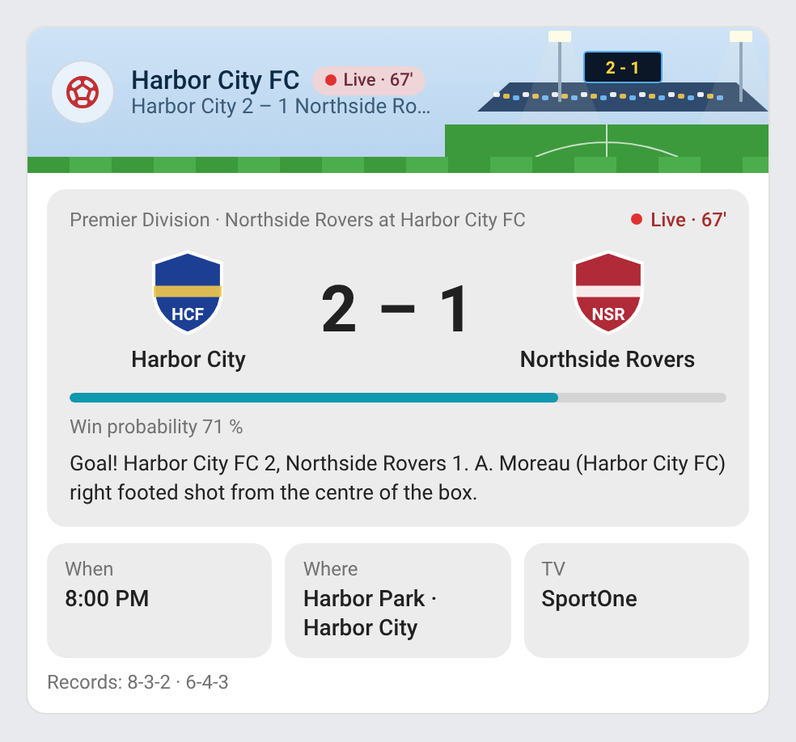 | 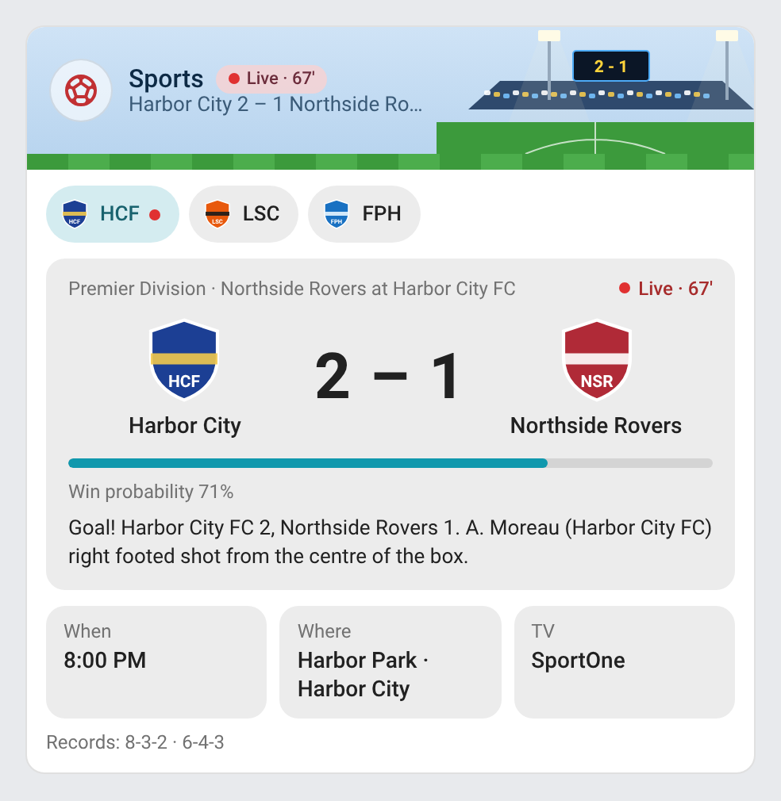 |

## Features

- **Live**: both crests and names, the score, the clock with its quarter or period, a bar of how far the game has gone (soccer minutes against 90, the quarters or periods of the other team sports), the win probability and the last play
- **Before kick-off**: the opponent, the date and time, how long until then, the odds; **after**: the result, won, lost or drawn
- **When, where, on which channel**: the date, the venue and the city, the TV network, then both teams' records
- **Several teams**: one tab per team (its crest, its abbreviation, a red dot while live); the card opens on the live game, else on the next one to start
- **Crests**: the team's logo when TeamTracker gives one, else a shield in the team's colours with its abbreviation
- **Illustrated header**: a stadium whose scoreboard shows the score; while the game is live the floodlights shine, the scoreboard's frame glows and the live dot blinks; the dark theme turns the picture to night
- **Mini card**: the state, the game as a chip and a small scoreboard over the stadium; its zoom button opens the full card in place
- **Tap the scoreboard** to open the sensor's details
- Visual editor for both cards, light and dark themes, 22 languages, no external dependency

## Supported integrations

The card reads the sensors of this integration, one sensor per team (its state is the game's: `PRE`, `IN`, `POST`, `BYE` or `NOT_FOUND`, its attributes the game):

| | Integration | What the cards show |
|:---:|---|---|
|  | [TeamTracker](https://github.com/vasqued2/ha-teamtracker) (Marketplace) | Live scores and the next game, from ESPN and other providers: football (soccer), American football, basketball, hockey, baseball, rugby… |

## Installation

### Via the Marketplace (recommended)

Click the button below to add the repository directly:

[](https://my.home-assistant.io/redirect/marketplace_repository/?owner=juju35&repository=ha-sports-card&category=plugin)

Or manually:

1. Open **Settings → Marketplace → Add from link** (top right; this needs a GitHub account connected)
2. Add `https://github.com/juju35/ha-sports-card` — Type: **Dashboard**
3. Open **Sports Card** and click **Install**
4. Clear your browser cache and refresh

The Marketplace registers the dashboard resource for you.

### Manual

1. Download `ha-sports-card.js` and the `ha-sports-card.i18n.*.js` translation files from the [latest release](https://github.com/juju35/ha-sports-card/releases/latest)
2. Copy them all to `/config/www/` (without the translation files, the cards show in English)
3. Go to **Settings → Dashboards → Resources** → Add resource:
   - URL: `/local/ha-sports-card.js`
   - Type: **JavaScript Module**
4. Clear your browser cache and refresh

## Configuration

Every option is in the visual editor. In YAML:

```yaml
type: custom:sports-card
entity: sensor.my_team

# Several teams: one tab each
type: custom:sports-card
entity: sensor.my_team
entities:
  - sensor.my_basketball_team
  - sensor.my_hockey_team

# Two lines on a phone dashboard
type: custom:sports-mini-card
entity: sensor.my_team
```

| Option | Type | Default | Description |
|---|---|---|---|
| `entity` | string | the first TeamTracker sensor | A TeamTracker sensor |
| `entities` | list | | More TeamTracker sensors: one tab per team (with `entity` first) |
| `title` | string | the team's name (`Sports` with several teams) | Both: card title |
| `show_title` | boolean | `true` | Both: show the title |
| `show_subtitle` | boolean | `true` | Both: the game under the title (the score, or the opponent and the kick-off) |
| `navigation_path` | string | | Both: a tap on the header opens this dashboard path |
| `show_details` | boolean | `true` | When, where, TV, the records and the odds |
| `show_last_play` | boolean | `true` | The last play while live |
| `illustration` | boolean | `true` | Both: the illustrated header (`false`: the classic header) |
| `illustration_theme` | string | `auto` | Both: `auto` (follows the Home Assistant theme: night with a dark theme, day with a light theme), `day` or `night` |
| `animations` | boolean | `true` | Both: the live dot, the scoreboard's glow |
| `zoom` | boolean | `true` | Mini card: the zoom button |
| `language` | string | Home Assistant's | Advanced: one of the [languages](#translations) |

## Screenshots

| Live | Before kick-off | After (won) |
|---|---|---|
|  | 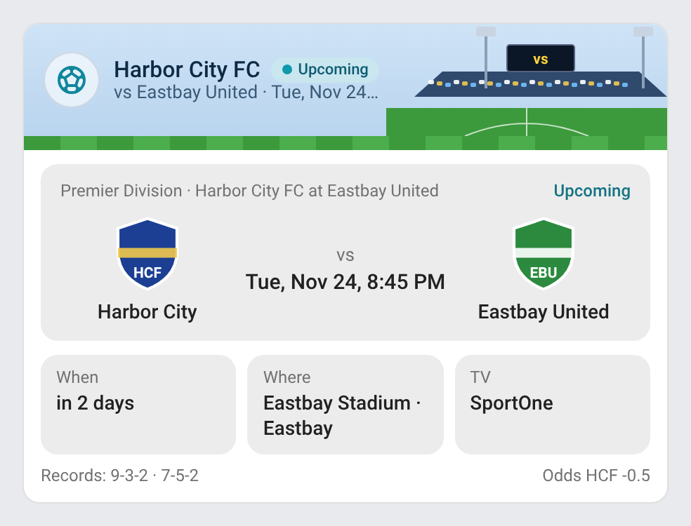 | 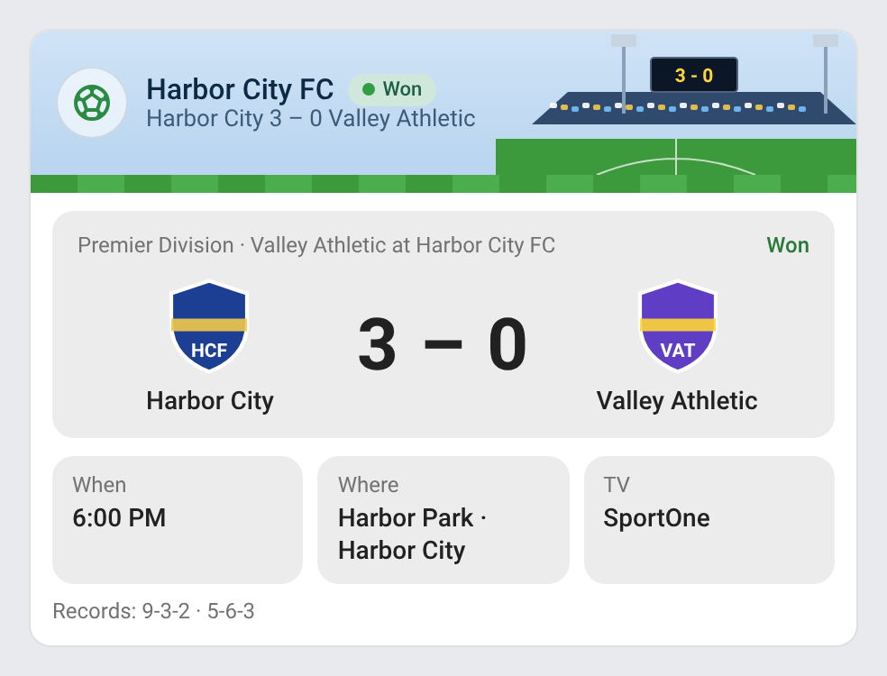 |
|  | 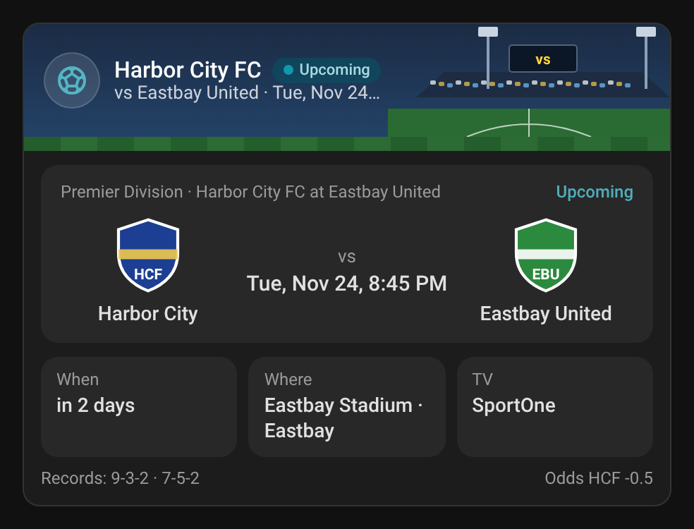 | 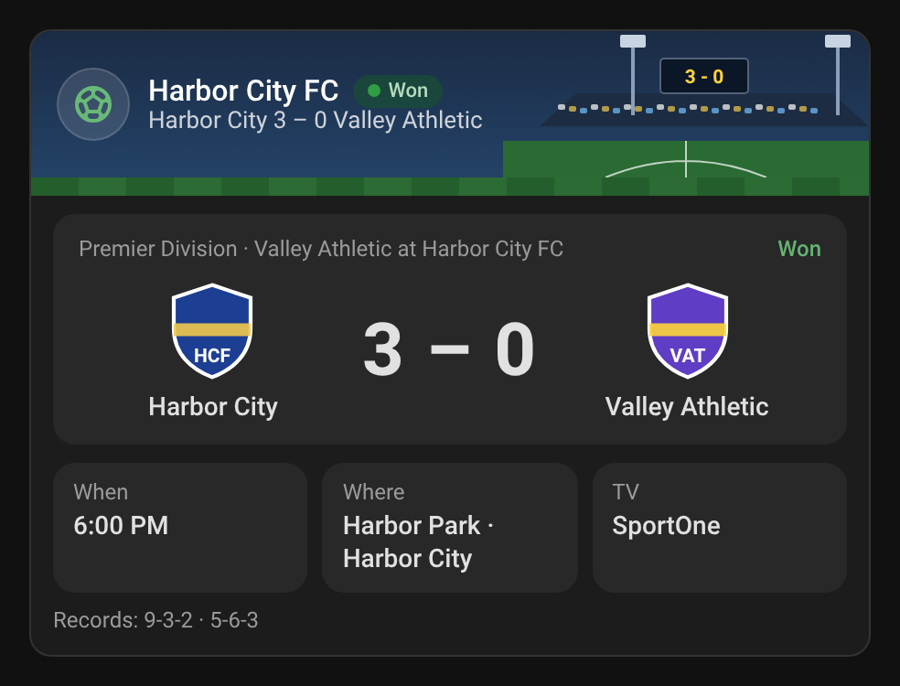 |

| Several teams | Bye week | Narrow |
|---|---|---|
|  | 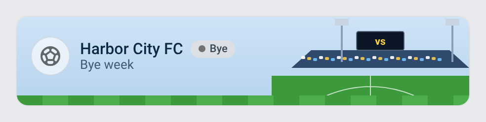 | 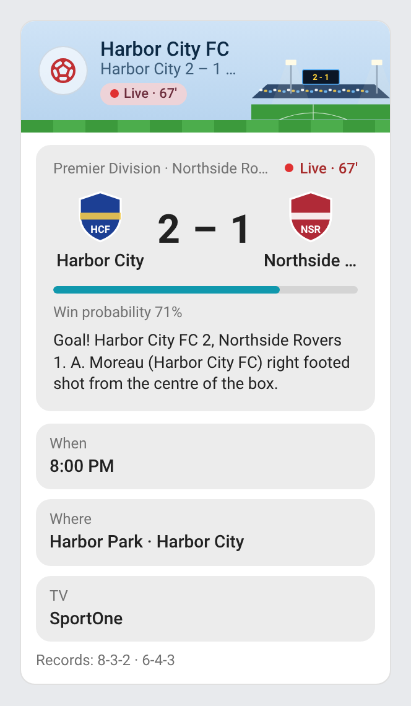 |
| 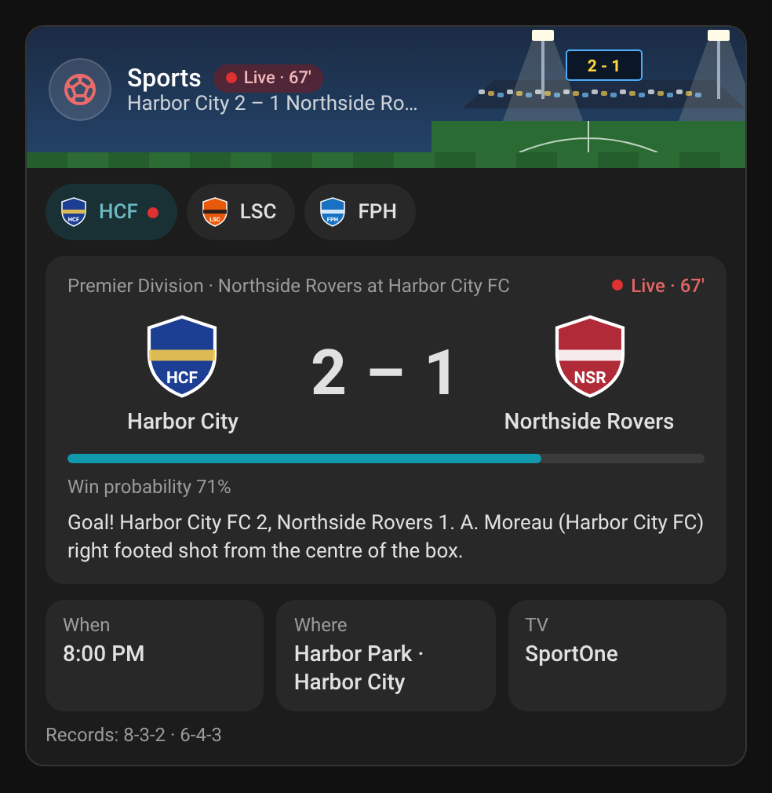 | 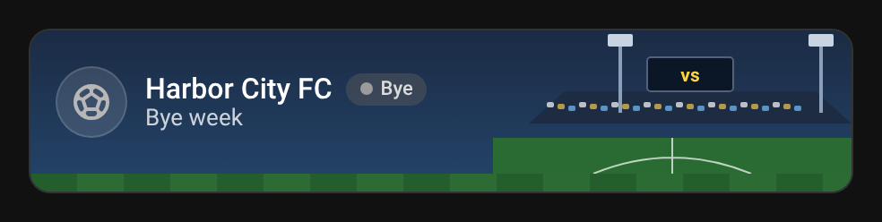 | 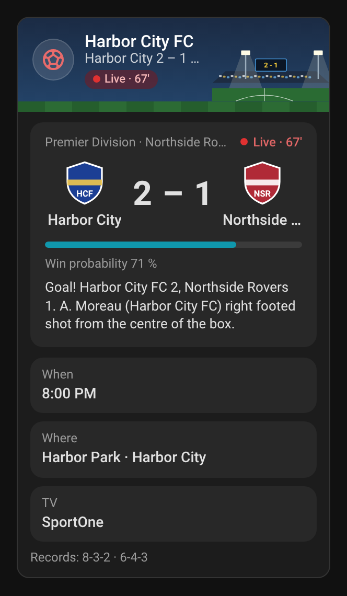 |

**Live animation**: the live dot blinks and the stadium's scoreboard glows (still with `animations: false`, or when the system asks for reduced motion).

| Light | Dark |
|---|---|
| 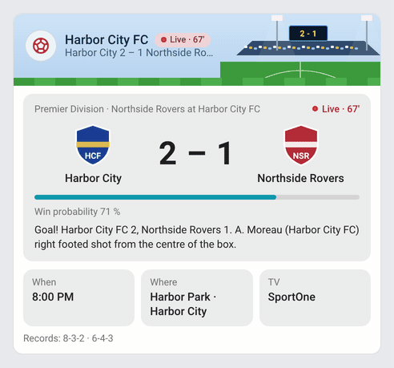 | 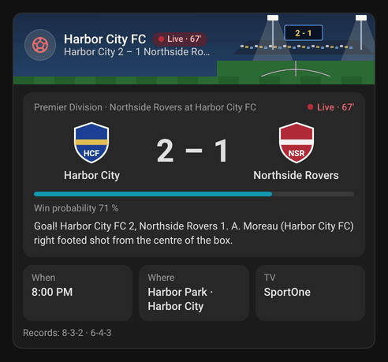 |

### Sports mini

| Live | Before kick-off | Zoomed in |
|---|---|---|
| 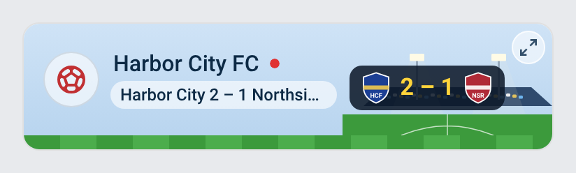 | 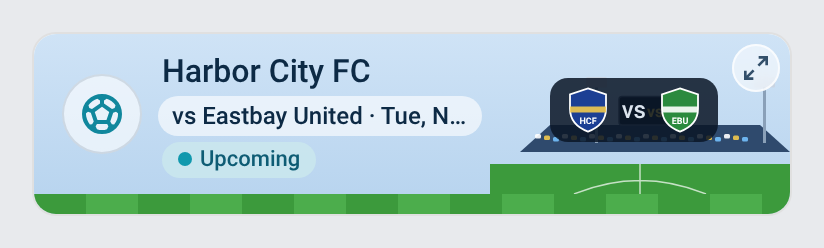 | 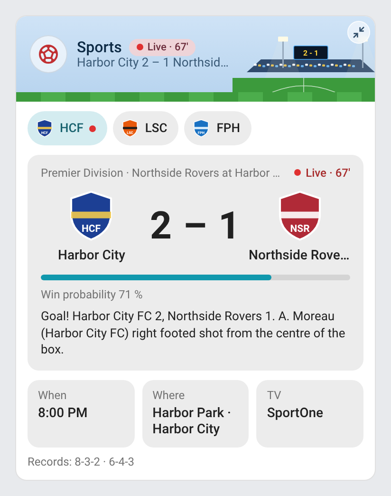 |
| 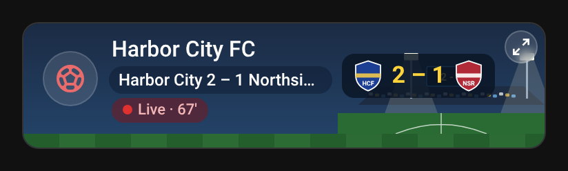 | 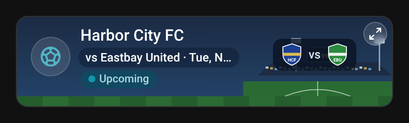 | 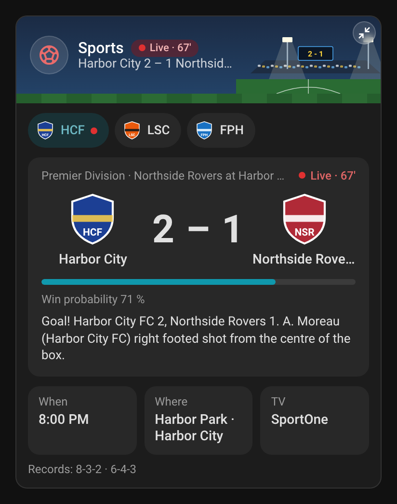 |

| Live animation | Dark |
|---|---|
| 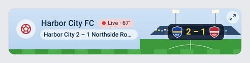 | 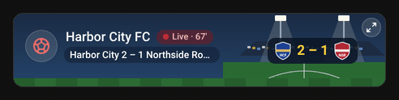 |

## How it works

- **Teams**: `entity` then `entities`, else the first TeamTracker sensor of the home (by its platform)
- **State**: `IN` is live, `PRE` before kick-off, `POST` after (won, lost or drawn from `team_winner` / `opponent_winner`, else the scores), `BYE` a week without a game, `NOT_FOUND` no game
- **Clock**: soccer's minute alone (`67'`); the quarter (American football, basketball), the period (hockey) or the half (rugby) before the clock of the other team sports; the bar of how far the game has gone comes from them
- **Default tab**: the live game, else the next game to start, else the first team
- **Crests**: `team_logo` / `opponent_logo` when given (loaded from the provider), else a shield drawn in `team_colors` / `opponent_colors` (else a colour from the name) with the abbreviation
- **Refresh**: the card follows the TeamTracker sensors (their own polling, faster during a live game); it fetches nothing itself
- **Read only**: the card calls no action

## Development

```bash
npm install
npm run build        # stamps the version of package.json into dist/ha-sports-card.js
npm run check        # builds and checks the bundle (run in CI)
npm test             # unit tests
npm run screenshots  # renders the cards with mock TeamTracker sensors into screenshots/ (and the GIFs, needs ffmpeg)
```

`dist/` is not committed: `npm run build` creates it locally, CI builds it on every push, and the release workflow attaches the built files to the release, which is where the Marketplace installs them from.

### Releasing

1. Bump `version` in `package.json`
2. Add a `## <version>` section at the top of [CHANGELOG.md](https://github.com/juju35/ha-sports-card/blob/main/CHANGELOG.md)
3. Push to `main`: the **Release** workflow builds the card, creates the tag and the GitHub release with the changelog section as notes, and attaches `ha-sports-card.js` and its translation files

## Translations

The card auto-detects the language from your Home Assistant settings. Currently supported:

| Language | Code |
|---|---|
| English | `en` |
| Français | `fr` |
| Deutsch | `de` |
| Español | `es` |
| Српски | `sr` |
| Srpski (latinica) | `sr-Latn` |
| Italiano | `it` |
| Nederlands | `nl` |
| Português (Portugal) | `pt` |
| Polski | `pl` |
| Română | `ro` |
| Dansk | `da` |
| Svenska | `sv` |
| Български | `bg` |
| Русский | `ru` |
| Українська | `uk` |
| Magyar | `hu` |
| Slovenčina | `sk` |
| Čeština | `cs` |
| Slovenščina | `sl` |
| Latviešu | `lv` |
| Ελληνικά | `el` |

Contributions for additional languages are welcome!

## License

[MIT](https://github.com/juju35/ha-sports-card/blob/main/LICENSE)

## Support

If you find this project useful, you can support its development:

<a href="https://buymeacoffee.com/julienstep9"></a>
